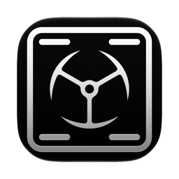

<p align="center">
  
</p>

<h1 align="center">Imperator HotCorners</h1>

<p align="center">
  Set the four macOS hot corners from the menu bar, or turn them all off with one switch.
  Quick and easy.
</p>

## Requirements

Requires macOS 26 or later, on Apple silicon or Intel. Built and tested on macOS 27 on Apple
silicon only. Older versions and Intel Macs are expected to work but have not been verified.

Install at your own risk. The app is not notarized and carries no Apple Developer signature, so
macOS cannot vouch for it. It is provided as is, with no warranty, under the
[MIT license](LICENSE).

## Install

Download the latest zip from
[Releases](https://github.com/goranimperator/imperator-hotcorners/releases), unzip, and move
`Imperator HotCorners.app` to `/Applications`.

The app is signed with a self-signed certificate and is not notarized, so Gatekeeper blocks the
first launch. Right-click the app and choose **Open**, or clear the quarantine flag:

```bash
xattr -dr com.apple.quarantine "/Applications/Imperator HotCorners.app"
```

An update you download later meets the same dialog, so run the command again after each one.

There is no Dock icon. The app lives in the menu bar.

## Permissions

The app requests no Accessibility, Input Monitoring, or Automation grants, and declares no
`NSUsage` keys. It reads and changes hot corners through the same two Dock functions System
Settings uses, and macOS asks for no permission for those.

**Open at Login**, the toggle in the panel footer, calls `SMAppService.mainApp.register()`,
which adds the app to Login Items in System Settings. Turning the toggle off unregisters it.

**Notifications.** Asked the first time there is a newer version to tell you about, never at
first launch. Allow it and you get one notification per new version; deny it and nothing
breaks, the new version still shows as a row in the panel.

**Network.** One request a day, the update check: a `GET` to
`api.github.com/repos/goranimperator/imperator-hotcorners/releases/latest`. It sends nothing but
the app's name and version as the User-Agent GitHub requires. No telemetry, no analytics, nothing
about you or your corners. Turn it off with **Check for updates** in the panel's footer.

## Use

Click the icon in the menu bar and a panel drops down. The four pop-ups sit where their corners
are: top left, top right, bottom left, bottom right. Whatever you already set in System Settings
shows up here, because the panel reads the Dock every time it opens. Clicking the icon again
closes the panel, as does Escape or a click in another app.

| Control | What it does |
|---------|--------------|
| Corner pop-up | Sets that corner's action. The change applies at once, and System Settings shows the same value |
| Hold ⌘, ⌥, ⌃ or ⇧ while choosing | Adds a modifier key, as in System Settings. The corner then fires only while those keys are held |
| Disable HotCorners switch, under the four pop-ups | Turns all four corners off, and back on |
| Open at Login | Starts the app when you log in |
| Check for updates | The daily check for a newer release, on by default |
| Check Now | Checks for a newer release straight away, even with the switch off |
| About | Version and copyright |
| Quit | Quits the app |

The actions and their order are the ones System Settings offers: Mission Control, Application
Windows, Desktop, Notification Center, Apps, Quick Note, Start Screen Saver, Disable Screen Saver,
Put Display to Sleep, Lock Screen, and "-" for no action.

Turning **Disable HotCorners** on sets every corner to "-" and remembers what each one did,
modifier keys included. Turning it off puts them back. While it is on, the pop-ups still work,
dimmed: what you choose then is what comes back when you turn it off, and the Dock is not touched
until you do. If you turn a corner on in System Settings while the corners are disabled, System
Settings wins and the switch goes back off.

If the Dock does not answer, or a change does not stick, a short notice in the panel says so,
with a button to try again or to open Desktop & Dock settings. Nothing is changed while a notice
about the Dock is showing. A switch that fails halfway is undone; if even that fails, the app keeps
the remembered corners, so turning the switch off again puts every one of them back.

**Updates.** Once a day the app asks GitHub whether a newer release is out. When there is one,
a row above the footer says so and sends one notification; **Download** and the notification
both open the release page. Installing is up to you, and a downloaded update meets Gatekeeper
like the first install: choose **Done** and run the `xattr` command from Install again.

The app keeps one thing of its own: the remembered corners while the corners are disabled, stored under
the `disabledSnapshot` key in the `com.goranimperator.ImperatorHotCorners` defaults domain.

## How it works

System Settings reads hot corners with `CoreDockGetExposeCornerActionsWithModifiers` and writes
them with `CoreDockSetExposeCornerActionWithModifier`, two private functions in HIServices that
send a message straight to the Dock. The app calls the same two. A change therefore lands
immediately, the Dock is never restarted, and System Settings shows it on its next open.

Both functions are loaded with `dlsym` at launch rather than linked. If a future macOS removes
them, the app still starts, shows a notice and links to Desktop & Dock settings instead.

The arguments were worked out from the System Settings binary and then measured on a real Dock
with `scripts/calibrate-dock.swift`: the setter takes (action, corner, modifiers), with corners
numbered 0 to 3 from top left, and modifiers are `NSEvent.ModifierFlags` bits. `SPEC.md` has the
details.

## Known limits

- The two Dock functions are private. A macOS update can change or remove them; the app then
  shows a notice instead of changing anything.
- A title with modifier keys can be wider than its column. The longer ones, such as
  "⌘ Disable Screen Saver" with more keys held, end in an ellipsis; the tooltip shows the full title.
- Hot corners are one set for all displays. That is how macOS works, and the app follows it.

## Build from source

```bash
make install
```

Builds release for Apple silicon and Intel, bundles, codesigns, installs to `/Applications`, and
launches. Other targets:

```bash
make run
```

```bash
make test
```

```bash
make clean
```

`platforms: [.macOS("26.0")]` in `Package.swift` makes macOS 26 the minimum and stamps
`minos 26.0 / sdk 26.0` into the binary. AppKit picks which generation of a control to draw from
that `sdk` field, so the stamp is what gives the switches and pop-ups their current look.

Signing uses the self-signed `Imperator Dev` identity by default. It has to be a stable identity
rather than ad-hoc: the login item registration is keyed to the bundle's designated requirement,
and ad-hoc signing mints a new hash on every build, so each update would look like a different app
and drop the registration. Override it if you do not care:

```bash
make build CODESIGN_IDENTITY=-
```

The binary has self-checks that measure instead of trusting constants. Each prints a line ending
in `_OK` and exits 0, or prints `FAIL` lines and exits 1:

```bash
.build/debug/ImperatorHotCorners --dock-check
```

```bash
.build/debug/ImperatorHotCorners --icon-check
```

```bash
.build/debug/ImperatorHotCorners --panel-check
```

```bash
.build/debug/ImperatorHotCorners --render-preview build/preview
```

`--dock-check` reads the Dock and compares it with the `wvous-*` preferences, without writing
anything. `--icon-check` measures the menu bar glyph in pixels. `--panel-check` opens the real panel on a fake Dock and drives it: its window level, the switch, Escape, a click in the menu bar, and the refit for a notice. `--render-preview` draws the panel
in every state, the glyph in both corner marks, and the menu order into `build/preview`. A debug
build started with `IMPERATOR_HOTCORNERS_FAKE=1` uses a fake Dock, so every control can be clicked
without touching your real corners. The fake is compiled out of release builds.

`GATES.md` lists the acceptance gates and how each one is checked.

## Release

Build a zip without touching git or the remote:

```bash
make dist VERSION=x.y.z
```

Cut a full release, which bumps `Info.plist`, commits, tags `vx.y.z`, pushes, and publishes a GitHub
release with the zip attached:

```bash
make release VERSION=x.y.z
```

Requires the [GitHub CLI](https://cli.github.com) (`brew install gh`, then `gh auth login`). The
working tree must be clean. Tags are plain semver (`v1.0.0`); the release title carries the app
name. `CFBundleVersion` is set from `git rev-list --count HEAD` and is never edited by hand.

`Resources/AppIcon.icns` is the source of the app icon. After replacing it, run `make icon` to
regenerate `Resources/AppIcon.png`, the 256 px image this README shows.

## Layout

| Path | Role |
|------|------|
| `Sources/HotCornersCore/CornerModel.swift` | `Corner`, `HotCornerAction`, `CornerModifiers`, `CornerSetting`, `CornerLayout` |
| `Sources/HotCornersCore/HotCornerBackend.swift` | The backend protocol, `DockError`, and `InMemoryBackend` for tests and previews |
| `Sources/HotCornersCore/CoreDockBackend.swift` | The `dlsym` bridge to the Dock and the calibrated corner numbers |
| `Sources/HotCornersCore/HotCornerStore.swift` | The state rules: refresh, choose, switch off and on, rollback, the remembered corners |
| `Sources/HotCornersCore/CornerMenu.swift` | The pop-up menu as data: System Settings' sections and order, modifier alternates |
| `Sources/ImperatorHotCorners/main.swift` | Entry point: runs a self-check and exits, or starts the app as `.accessory` |
| `Sources/ImperatorHotCorners/AppDelegate.swift` | Status item, panel, store wiring, forced dark mode and red accent |
| `Sources/ImperatorHotCorners/MenuBarPanel.swift` | The menu bar panel itself: corner, material, dismissal |
| `Sources/ImperatorHotCorners/PopoverContentView.swift` | Header, notices, the corner grid with the Disable HotCorners switch under it, footer |
| `Sources/ImperatorHotCorners/CornerPopUp.swift` | One corner's native `NSPopUpButton`, built from `CornerMenu` |
| `Sources/ImperatorHotCorners/StatusItemIcon.swift` | The glyph: a screen frame with a mark in each corner |
| `Sources/ImperatorHotCorners/Theme.swift` | Brand colour, switch style, `HoverButton`, `LaunchAtLoginToggle` |
| `Sources/ImperatorHotCorners/AboutPanel.swift` | Brand book §10 About panel, `NSPanel` 300x260pt |
| `Sources/ImperatorHotCorners/UpdateChecker.swift` | The daily check for a newer release on GitHub, and its one notification |
| `Sources/HotCornersCore/ReleaseVersion.swift` | Numeric version comparison for the update check |
| `Sources/ImperatorHotCorners/DebugBackend.swift` | The fake Dock for debug builds |
| `Sources/ImperatorHotCorners/Checks/` | The self-checks: `DockCheck.swift` (`--dock-check`), `IconCheck.swift` (`--icon-check`), `PanelCheck.swift` (`--panel-check`), `AboutCheck.swift` (`--about-check`), `PreviewRender.swift` (`--render-preview`) |
| `Tests/HotCornersCoreTests/` | Unit tests for the model, the Dock bridge, the store and the menu |
| `scripts/calibrate-dock.swift` | Measures the Dock setter's arguments on a real Dock, undoing every change |
| `scripts/check-dashes.mjs`, `scripts/check-brand.mjs` | Text and brand gates |
| `Resources/` | `Info.plist` and the app icon |
| `SPEC.md`, `GATES.md` | Design with the verified Dock facts, and the acceptance gates |

The menu bar panel is drawn by `MenuBarPanel`, an `NSPanel`, rather than by `NSPopover`. macOS 27
draws its own menu bar panels as plain rounded rectangles with no arrow and no open or close
animation, and `NSPopover` draws neither that shape nor that corner and exposes no radius to set.
The panel is 400 pt wide instead of the brand book's 340, because two columns of pop-ups need
176 pt each for the longest action title.

The logic lives in `HotCornersCore`, a library with no AppKit in it, so every rule in the store
is covered by unit tests against `InMemoryBackend` and never touches the real Dock.

## Third-party

None. The app uses only Apple frameworks.

## License

[MIT](LICENSE) &copy; Goran Imperator
